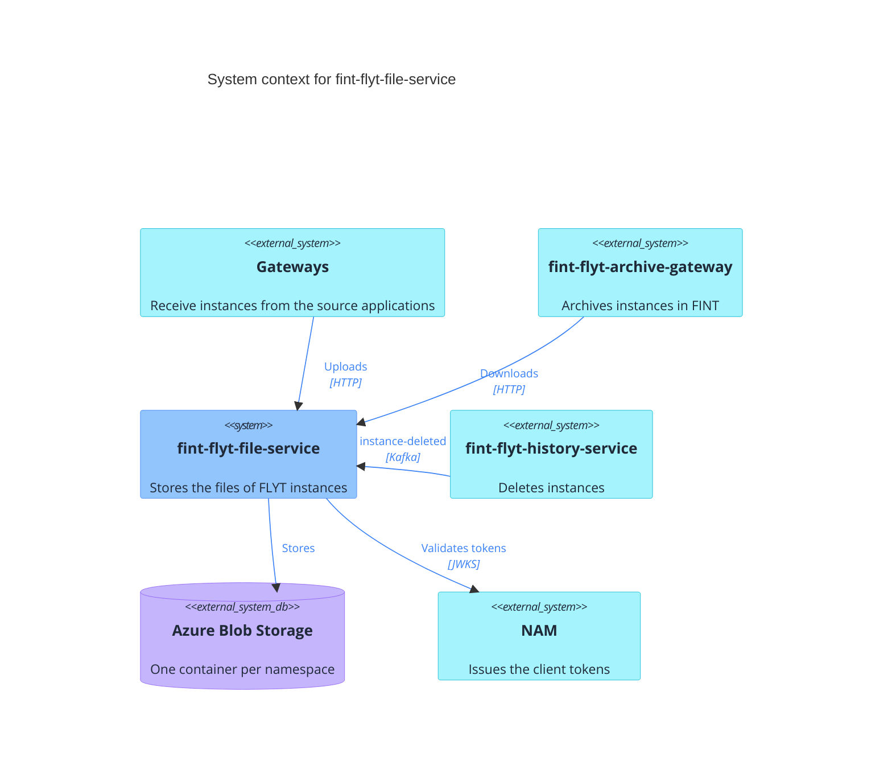
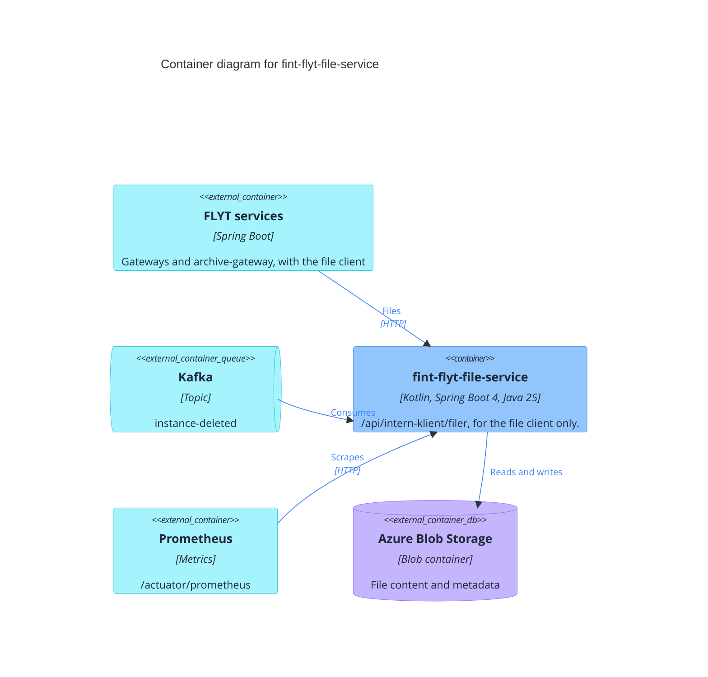
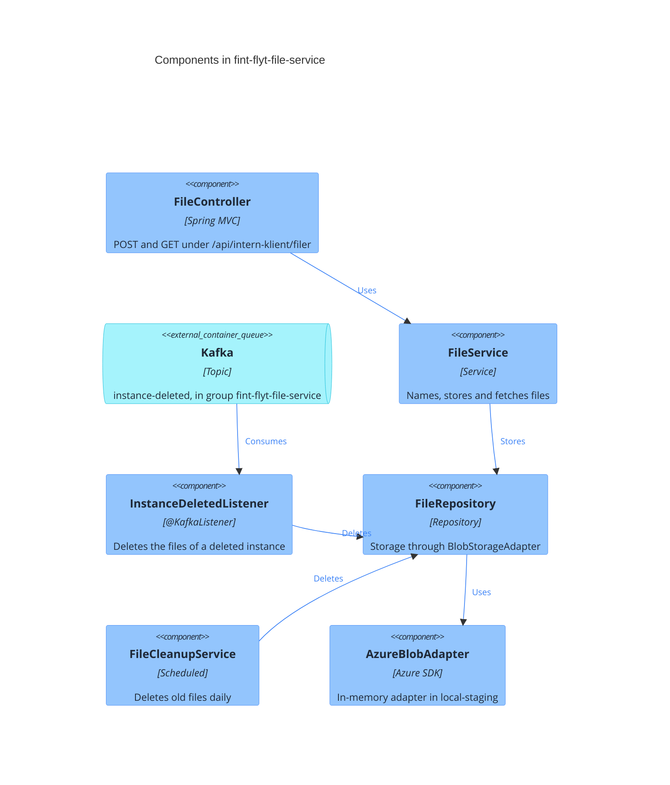

# Architecture

fint-flyt-file-service stores the files that come with FLYT instances. Gateways upload the files when an instance is
received, and archive-gateway downloads them when it archives the instance. The files are deleted when the instance is
deleted, and by a daily cleanup.

## C4 level 1: System context

## C4 level 2: Container

One Spring Boot application. The files are in Azure Blob Storage, with an in-memory store for `local-staging`.

flyt-security-starter only lets the namespace's file client (`fint.sso.client-id`), which the gateways and
archive-gateway use, call the API.
`/actuator/health/**` and `/actuator/prometheus` are open; everything else is denied.

## C4 level 3: Components

A record on `instance-deleted` without instance flow headers is skipped. A failed deletion is logged and skipped, with
no retries, so the daily cleanup removes what is left.
